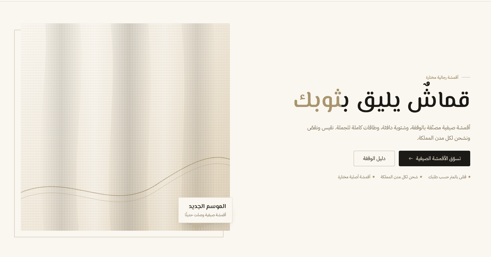
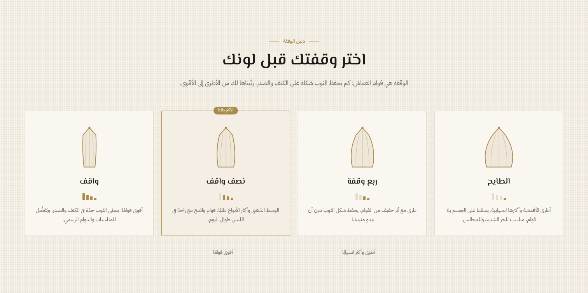
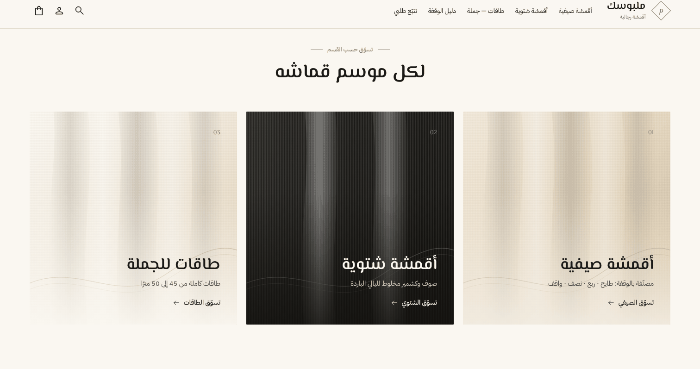
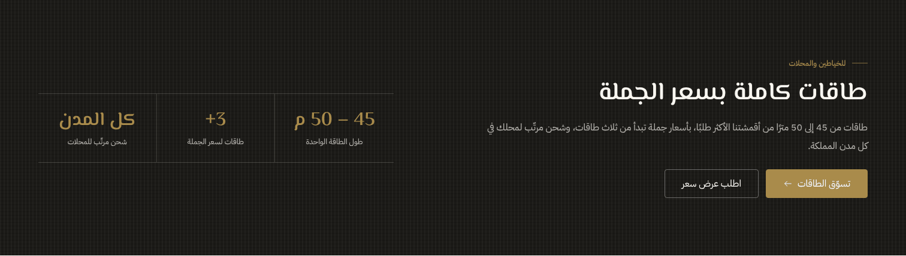

# ثيم ملبوسك لمنصة زد

ثيم فاخر هادئ لمتجر **ملبوسك** على منصة زد: خلفية عاجية، نص داكن، ولمسة ذهبية واحدة.
مبني على محرّك الثيمات الجديد في زد (**Vitrin**)، وعلى أساس الثيم الرسمي من زد
([Growth](https://github.com/zidsa/growth-theme))، فكل ما يخص السلة والدفع وخيارات المنتج
والتقييمات وتسجيل الدخول يعمل كما صمّمته زد، والتصميم والأقسام فوقه خاصة بملبوسك.

| | |
|---|---|
| **المحرّك** | Vitrin (Jinja) — ثيمات Twig القديمة لم تعد مدعومة في زد |
| **اللغة** | عربي أولًا (RTL)، والإنجليزي مدعوم |
| **الخطوط** | المسيري للعناوين، IBM Plex Sans Arabic للنصوص — قابلة للتغيير |
| **الألوان** | `#FAF7F1` عاجي · `#1B1A17` داكن · `#A98B4B` ذهبي — قابلة للتغيير |

---

## التركيب على متجرك

### الطريقة الأولى: رفع الملف من لوحة زد

1. حمّل الملف الجاهز [`malbousak-zid-theme.zip`](../malbousak-zid-theme.zip).
2. من لوحة تحكم زد افتح **متجر الثيمات**، وانزل لآخر الصفحة إلى **الثيمات المخصصة**، ثم ارفع الملف.
3. فعّل الثيم، ثم افتح **تخصيص الثيم** ورتّب الأقسام (التفاصيل تحت).

> رفع الثيمات المخصصة متاح بحسب باقة متجرك (عادةً باقة احترافية فأعلى، أو حين تُفعَّل لك صلاحية الثيمات من زد). إن لم تجد الخيار، استعمل الطريقة الثانية.

### الطريقة الثانية: أداة Vitrin من زد (حساب شريك مجاني)

```bash
npm install -g @zidsa/vitrin-cli
vitrin login                      # يفتح المتصفح لتسجيل الدخول بحساب شركاء زد
cd fabric/zid-theme
npm install
vitrin push --store <رقم المتجر> --activate
vitrin preview --store <رقم المتجر>
```

`vitrin push` يبني ملفات CSS و JS تلقائيًا قبل الرفع.

---

## الصفحة الرئيسية — الترتيب المقترح

أضف هذه الأقسام من **تخصيص الثيم ← الصفحة الرئيسية ← إضافة قسم**. كل قسم يظهر بمحتوى ملبوسك
جاهز من أول لحظة، وتعدّله متى شئت.

| # | القسم | ما يعرضه |
|---|---|---|
| 1 | **ملبوسك · البانر الفاخر** | عنوان كبير بكلمة ذهبية، زرّان، ومزايا قصيرة. بلا صورة تظهر لوحة قماش مرسومة |
| 2 | **ملبوسك · المزايا** | قصّ بالمتر · شحن لكل المدن · أقمشة أصلية · دفع آمن (اختر الخلفية الرملية) |
| 3 | **ملبوسك · الأقسام** | ثلاث بطاقات: صيفي، شتوي، طاقات — اربط كل بطاقة بتصنيفها |
| 4 | **قائمة المنتجات** | «الأكثر مبيعًا» |
| 5 | **ملبوسك · دليل الوقفة** | الطايح · ربع وقفة · نصف واقف · واقف، برسم يوضّح سقوط القماش ومقياس القوام |
| 6 | **قائمة المنتجات** | «مختارات الشتاء» أو أي مجموعة |
| 7 | **ملبوسك · حاسبة الأمتار** | «كم مترًا أحتاج؟» حسب الطول وعدد الأثواب |
| 8 | **ملبوسك · الجملة والطاقات** | شريط داكن للخياطين والمحلات، مع زر واتساب لطلب عرض سعر |
| 9 | **ملبوسك · حكايتنا** | صورة ونص عن المتجر وتوقيع |

<p align="center">
  
  
  
  
</p>

**قوائم الأقسام الفارغة:** في الأقسام والوقفة والمزايا والأرقام، إن تركت القائمة فارغة يظهر محتوى ملبوسك
الافتراضي. بمجرد أن تضيف عنصرًا واحدًا تظهر عناصرك أنت فقط.

---

## الإعدادات العامة

من **تخصيص الثيم ← إعدادات التخطيط**:

| المجموعة | ما فيها |
|---|---|
| **الخط** | خط النصوص، و**خط العناوين** (المسيري · أميري · ريم كوفي · نوتو نسخ · نفس خط النصوص) |
| **ألوان الثيم** | كل ألوان الثيم تُشتق منها، فتغيير اللون الذهبي مثلًا يغيّر كل اللمسات الذهبية |
| **هوية ملبوسك** | رقم واتساب والزر العائم · حاسبة الأمتار في صفحة المنتج وجدولها · رابط دليل الوقفة · المزايا القصيرة تحت زر الشراء |
| **بطاقة المنتج** | عدد الأعمدة وشكل الصورة (طولية افتراضيًا لتناسب صور القماش) |

ومن **أعلى الصفحة**: الشعار (وإن لم ترفعه يظهر اسم المتجر بخط العناوين مع شعار ذهبي وسطر
«أقمشة رجالية»)، وشريط الإعلانات المتحرك.
ومن **أسفل الصفحة**: لون التذييل (داكن أو فاتح)، والنص التعريفي، ومجموعات الروابط.

---

## نصائح لمتجر أقمشة على زد

* **فلتر الوقفة في صفحة التصنيف:** أضف خاصية للمنتجات باسم «الوقفة» بقيمها الأربع، فيظهر فلتر
  الوقفة في صفحة التصنيف تلقائيًا. بعدها انسخ رابط التصنيف وهو مفلتر، وضعه في بطاقة الوقفة المطابقة
  في قسم «دليل الوقفة»، فيصير الضغط على «نصف واقف» يعرض أقمشة النصف واقف فقط.
* **شارة الوقفة على صورة المنتج:** استعمل «شارة المنتج» في زد واكتب فيها الوقفة (مثل «نصف واقف»)
  فتظهر على البطاقة بألوان الثيم.
* **البيع بالمتر:** الكميات في زد أعداد صحيحة، فلا يمكن طلب 3.5 متر بالكمية. الحل الأنظف أن تجعل
  المقدار **خيارًا للمنتج** (3 م · 3.5 م · 4 م · 4.5 م) ولكل خيار سعره، أو أن تسعّر بنصف المتر.
  الحاسبة في صفحة المنتج تقترح المقدار، والعميل يختار الخيار المطابق.
* **الطاقات:** اجعلها تصنيفًا مستقلًا («طاقات — جملة»)، واربط به زر قسم «الجملة والطاقات».

---

## ما الذي تغيّر عن ثيم Growth

| | |
|---|---|
| `assets/css/malbousak.css` | طبقة الهوية: العناوين، الأزرار، الرأس، التذييل الداكن، وكل أقسام ملبوسك |
| `sections/malbousak-*` | سبعة أقسام جديدة، لكل قسم قالبه وإعداداته وصورة معاينته |
| `components/malbousak/` | الشعار النصي، لوحة القماش المرسومة، رسم الوقفة، الأيقونات، حاسبة الأمتار، زر واتساب |
| `assets/js/features/meter-calculator.js` | منطق الحاسبة |
| `layout.*` · `header.*` · `footer.*` | ألوان وخطوط ملبوسك الافتراضية، وإعدادات «هوية ملبوسك» ولون التذييل |
| `product-card` · `merchant-badge` · `product.jinja` | بطاقة منتج أهدأ، شارات بألوان الثيم، والحاسبة والمزايا في صفحة المنتج |
| `locale/ar/.../messages.po` | ترجمة النصوص الجديدة |

كل ما عدا ذلك من ثيم زد الرسمي كما هو. التوثيق التقني الأصلي في [`DEVELOPERS.md`](DEVELOPERS.md).

### للتطوير

```bash
npm install
npm run dev        # مراقبة وبناء CSS و JS أثناء التعديل
npm run build      # بناء نهائي
npm run package    # بناء + ملف build/malbousak-theme.zip الجاهز للرفع
```
